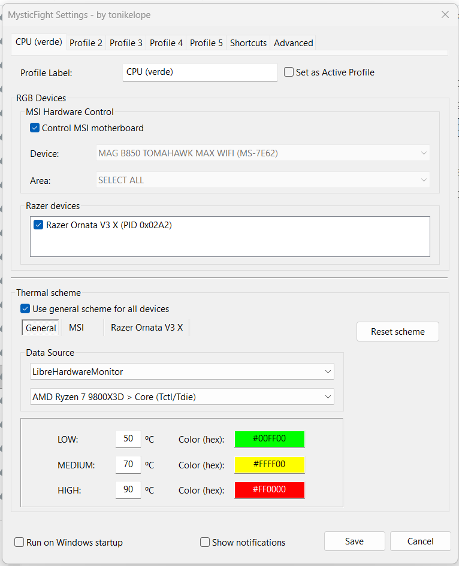

  
# MysticFight

Temperature-driven RGB control for MSI Mystic Light and explicitly supported Razer HID devices.

## ❓ Why MysticFight?
Let's be honest: the official **Mystic Light** software is often unreliable, and "fails more than a fairground shotgun". 

The main issue with Mystic Light CPU temperature profile: **it fails randomly after a system reboot**, forcing you to manually open MSI Center and navigate to the Mystic Light section every single time just to get it working again. It seems that they fix it in one update but break it in the next, in a endless loop. This is simply intolerable. 

Fortunately, while Mystic Light "client" is a mess, people who programmed the **SDK** actually did a good job. **MysticFight** bypasses the buggy MysticLight interface and talks directly to the SDK.

## Features
* **Real-time Monitoring:** Temperature tracking via HTTP.
* **VERY Lightweight:** No heavy dashboards, just a simple tray app that stays out of your way.
* **Customizable Device and LED area:** Choose the one you prefer. <i>Please note that MSI Mystic Light SDK may not recognise all areas available on your device (you will have to wait for MSI to update the public SDK)</i>.
* **Independent controllers per profile:** Control the MSI motherboard and any individually selected compatible Razer device. New profiles start with no RGB device selected.
* **Native Razer HID support:** Direct Windows HID control with no Synapse, Chroma Runtime, OpenRGB, extra service, or kernel driver. The validated models are Ornata V3, Ornata V3 X, Ornata V3 Tenkeyless and Tartarus Pro (exact PIDs below).
* **True multi-device Razer control:** Every compatible physical Razer HID device is shown by its reported product name and PID, and tracked internally by a stable device key. Profiles can independently select none, one, or several supported devices. Models outside the explicit compatibility table are omitted from Settings and never receive commands.
* **Shared or per-device thermal schemes:** Every profile uses one shared scheme for all selected controllers by default, preserving full backward compatibility. Its device tab bar stays hidden while **Use the same scheme for all devices** is enabled. Disable that option to show only the selected MSI and Razer device tabs and configure each data source, sensor, temperature threshold and colour scheme independently. Unselecting a controller hides its tab without deleting its saved scheme.
* **Configurable device hand-off:** When a profile stops using an MSI or Razer device, MysticFight exits normally, or Windows commits a shutdown/restart, Advanced settings can leave it powered off or return it to an autonomous animated effect (an exact MSI SDK-advertised style, or Razer Spectrum Cycling). The default is lights off, and MysticFight never hands off a device it did not successfully control first. Only when MysticFight closes with MSI release set to Off, it first pre-clears the retained colour to black and then applies the literal SDK `Off` style, reducing visible stale-colour restoration on a later cold boot without changing the lights-off hotkey or profile hand-off paths and without claiming undocumented firmware persistence.
* **Independent refresh rates:** MSI and every selected, supported Razer device can independently use 15, 20, or 25 FPS while consuming its assigned sensor. The Razer scheduler keeps separate smoothing and write deadlines per physical device, so different sensors, colour schemes and FPS values do not interfere. FPS limits transition speed: stable colours generate no repeated lighting writes or high-frequency rendering.
* **Customizable Data Source and Temperature Sensor:** LibreHardwareMonitor and its selected temperature sensor can be shared by enabling **Use the same scheme for all devices**, or assigned independently to each selected controller. The LibreHardwareMonitor server URL remains one global Advanced setting.
* **Customizable Temperature and Colors Thresholds:** RMS interpolation with adaptive colour-transition smoothing, shared by all devices or configured independently per selected controller.
* **Dynamic profiles:** Five profiles are created by default, with support for up to 50. A compact **+** tab immediately after the last existing profile creates another one; inactive profiles can be deleted after an explicit irreversible-action confirmation, while the active profile and the final remaining profile are protected. Creation and deletion are saved immediately. Each profile tab uses its label's natural full width, the profile strip scrolls when needed, and Shortcuts and Advanced remain pinned on the right. The **+** tab disappears at 50 profiles and returns after a deletion. Tray switching and the scrollable Shortcuts panel cover every profile; shortcut rows use the current profile labels, and deleting a profile reindexes its shortcut with it.
* **Opt-in global shortcuts:** Every profile and the lights toggle can have an independent global shortcut. All shortcuts start unassigned, including newly created profiles.
* **Focused shortcut capture:** Global shortcuts are suspended while Settings is open. A clear capture indicator appears only while a shortcut box has focus, and capture ends as soon as a combination is accepted so later keystrokes cannot silently replace it.
* **SDK auto-reset:** Automatic reset mechanism for the Mystic Light service in case of failure.
* **Reliable MSI cold-start output:** MysticFight waits for the first valid sensor sample and applies the same real thermal `Steady` state twice during initial startup, restoring the last known reliable MSI sequence without emitting a provisional colour. Normal rendering, profile changes and OFF/ON operations retain their event-driven single-write behaviour.
  

### Timing and idle behaviour

* With the lights enabled, LibreHardwareMonitor is still sampled at the configured 250, 500 (default), or 1000 ms interval. With the lights globally disabled, the existing low-power interval is 5 seconds.
* One `/data.json` download and one JSON parse serve every sensor required by the active profile during each polling cycle. Assigning different sensors to MSI and multiple Razer devices does not multiply HTTP requests.
* The configured 15, 20, or 25 FPS is the maximum colour-transition cadence (approximately 66, 50, or 40 ms per step), not a continuous device-write rate. Smoothing continues at that cadence until the visible RGB reaches its target.
* Each Razer device maintains its own interpolation state. Two selected devices can therefore follow different thermal thresholds and colours without coupling their frame schedules.
* Once a colour is stable, MSI and Razer stop high-frequency rendering and send no repeated lighting command. A sensor/source change, configuration change, device deadline, retry, or shutdown wakes the relevant worker immediately.
* MSI profile changes retain the last valid sensor snapshot, while profile and settings changes retain the current output mode. They update the colour directly without pretending that LibreHardwareMonitor was lost or reapplying `Steady` to an unchanged target. Startup waits for the first valid sample and applies two identical real-colour passes; it never emits a provisional white frame. White breathing remains reserved for a confirmed loss of an already working data source.
* After 60 seconds without SDK progress while active, the MSI heartbeat performs a non-lighting device query. While MSI output is not controlled, the same health check uses the existing 5-minute interval. Successful heartbeat logs remain throttled to one every 10 minutes.
* Razer performs read-only device detection and any throttled KVM reopen attempt on a 5-second deadline. Detection itself never sends a lighting command.
* During a committed Windows shutdown or restart, the window keeps `WM_ENDSESSION` active for at most four seconds while the existing MSI and Razer workers finish their configured release attempts. The UI thread never calls either hardware transport directly.
  
## ⚠️ Requirements
For this tool to work, you MUST have the following installed/running:

1. **MSI Center (only for MSI control):** [Download here](https://www.msi.com/Landing/MSI-Center). (Just installed, its not required to load with Windows. But remember you must install and enable the **Mystic Light** module inside it to provide the underlying drivers for SDK).
   * Disable **both** options in Mystic Light config: overwrite third part RGB and power saving mode. (It is highly recommended to also disable automatic updates for MSI Center and Mystic Light).
2. **LibreHardwareMonitor:** [Download here](https://github.com/LibreHardwareMonitor/LibreHardwareMonitor/releases/latest). Must be running (minimized on tray) to provide temperature data via Web Server (You must enable Remote Web Server in LHM options menu). <i>Note: Yes, I know there is a LibreHardwareMonitorLib available, but I don't have the time or inclination to mess around with CLR DLL wrappers such when LHM client works perfectly well for this task, is lightweight and useful for other popular monitoring applications such as RainMeter</i>.

### Supported Razer devices

| Device | USB PID | Lighting geometry |
| --- | --- | --- |
| Razer Ornata V3 | `0x02A1` | 10 zones |
| Razer Ornata V3 (Alternate) | `0x028F` | 10 zones |
| Razer Ornata V3 X | `0x0294` | 1 zone |
| Razer Ornata V3 X (Alternate) | `0x02A2` | 1 zone |
| Razer Ornata V3 Tenkeyless | `0x02A3` | 8 zones |
| Razer Tartarus Pro | `0x0244` | 21 zones |

Compatibility means temperature-driven uniform colour plus the configurable Off/Spectrum release behaviour. It does not imply support for every feature exposed by the device. Other Razer models are deliberately omitted from Settings and are never written to until their complete command recipe, transport interface and lighting geometry have been validated.

This table is the currently implemented and validated scope, not a permanent limitation of MysticFight or Razer hardware. More Razer models can be added through explicit per-PID profiles after their required commands, HID interface, feature-report length and lighting geometry have been verified. Until such a profile exists, the model stays outside the UI and cannot receive commands.

The exact Razer protocol scope and safety decisions are documented in [RAZER_HID_PROTOCOL.md](RAZER_HID_PROTOCOL.md).

## Acknowledgements

The documented Razer HID command structures used by MysticFight were informed by the excellent reverse-engineering work of the [OpenRazer project](https://github.com/openrazer/openrazer) and cross-checked against [openrazer-win](https://github.com/Ar4ikov/openrazer-win). MysticFight does not bundle or require either project. On Windows it communicates directly with only the explicitly supported devices above.

