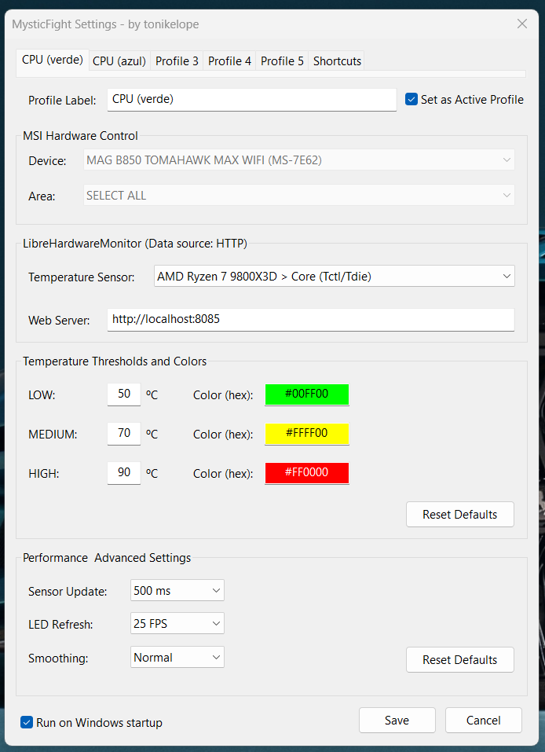
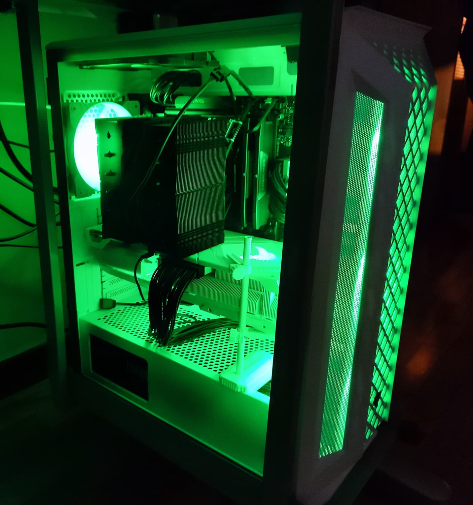

  
# MysticFight

Temperature-driven RGB control for MSI Mystic Light and the Razer Ornata V3 / V3 X.

## ❓ Why MysticFight?
Let's be honest: the official **Mystic Light** software is often unreliable, and "fails more than a fairground shotgun". 

The main issue with Mystic Light CPU temperature profile: **it fails randomly after a system reboot**, forcing you to manually open MSI Center and navigate to the Mystic Light section every single time just to get it working again. It seems that they fix it in one update but break it in the next, in a endless loop. This is simply intolerable. 

Fortunately, while Mystic Light "client" is a mess, people who programmed the **SDK** actually did a good job. **MysticFight** bypasses the buggy MysticLight interface and talks directly to the SDK.

## Features
* **Real-time Monitoring:** Temperature tracking via HTTP.
* **VERY Lightweight:** No heavy dashboards; just a simple tray app that stays out of your way.
* **Customizable Device and LED area:** Choose the one you prefer. <i>Please note that MSI Mystic Light SDK may not recognise all areas available on your device (you will have to wait for MSI to update the public SDK)</i>.
* **Independent controllers per profile:** Control the MSI motherboard and any individually selected compatible Razer device. New profiles select no Razer device by default.
* **Native Razer Ornata V3 / V3 X support:** Direct Windows HID control with no Synapse, Chroma Runtime, OpenRGB, extra service, or kernel driver. Settings inventories every physical Razer HID device in a fixed-height scrollable list; only models with a validated protocol are selectable.
* **True multi-device Razer control:** Every detected physical device is identified by its reported product name, PID, and stable device key. Profiles can independently select none, one, or several compatible Razer devices.
* **Configurable device hand-off:** When a profile stops using an MSI or Razer device (or MysticFight exits normally), Advanced settings can leave it powered off or return it to an autonomous animated effect (an exact MSI SDK-advertised style, or Razer Spectrum Cycling). The default is lights off, and MysticFight never hands off a device it did not successfully control first.
* **Independent refresh rates:** MSI and every physical Razer device can independently use 15, 20, or 25 FPS while sharing the same thermal color and smoothing engine. The Razer scheduler keeps a separate deadline per device, so a 15 FPS device is not quantized by a 25 FPS device.
* **Customizable Temperature Sensor:** Choose the one you prefer.
* **Customizable Temperature and Colors Thresholds:** RMS interpolation with adaptive color transition smoothing.
* **5 profiles settings:** You can set a custom global shortcut keys to change between profiles.
* **Night-Mode:** You can set a custom global shortcut keys to power-off/on LEDs.
* **SDK auto-reset:** Automatic reset mechanism for the Mystic Light service in case of failure.
  

  
## ⚠️ Requirements
For this tool to work, you MUST have the following installed/running:

1. **MSI Center (only for MSI control):** [Download here](https://www.msi.com/Landing/MSI-Center). (Just installed, its not required to load with Windows. But remember you must install and enable the **Mystic Light** module inside it to provide the underlying drivers for SDK).
   * Disable **both** options in Mystic Light config: overwrite third part RGB and power saving mode. (It is highly recommended to also disable automatic updates for MSI Center and Mystic Light).
2. **LibreHardwareMonitor:** [Download here](https://github.com/LibreHardwareMonitor/LibreHardwareMonitor/releases/latest). Must be running (minimized on tray) to provide temperature data via Web Server (You must enable Remote Web Server in LHM options menu). <i>Note: Yes, I know there is a LibreHardwareMonitorLib available, but I don't have the time or inclination to mess around with CLR DLL wrappers such when LHM client works perfectly well for this task, is lightweight and useful for other popular monitoring applications such as RainMeter</i>.

The Razer protocol scope and safety decisions are documented in [RAZER_ORNATA_V3_PROTOCOL.md](RAZER_ORNATA_V3_PROTOCOL.md).

## Acknowledgements

The documented Razer HID command structures used by MysticFight were informed by the excellent reverse-engineering work of the [OpenRazer project](https://github.com/openrazer/openrazer). MysticFight does not bundle or require OpenRazer; on Windows it communicates directly with the explicitly supported devices.

